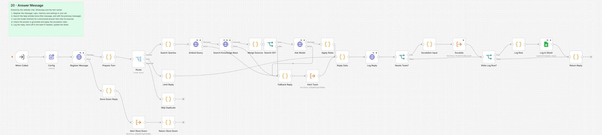
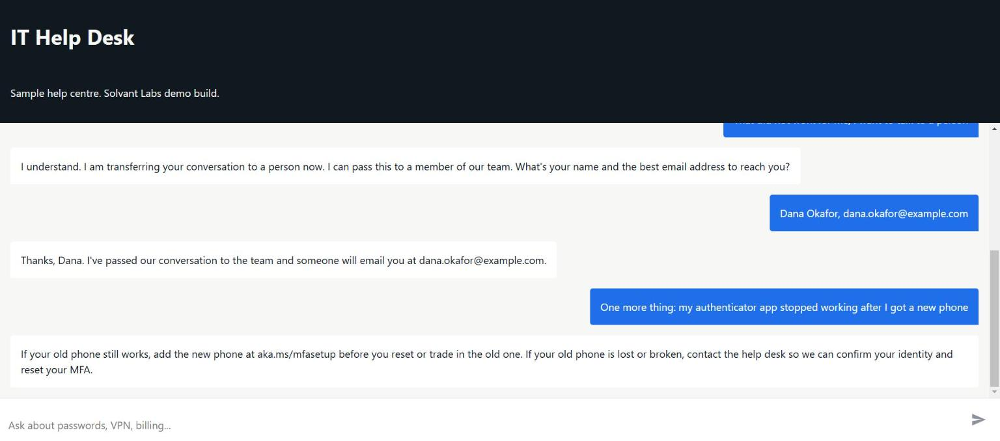
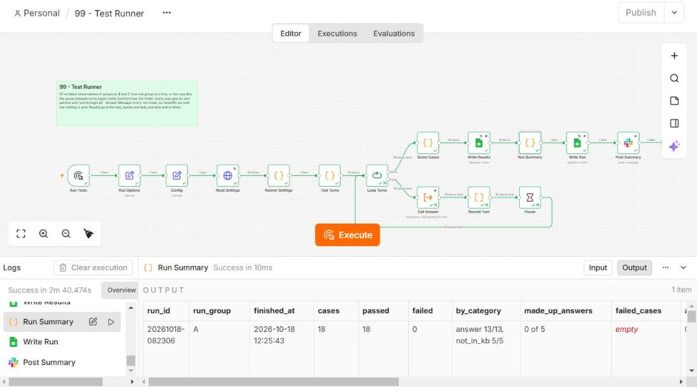

# RAG support chatbot on n8n: website chat and WhatsApp, Supabase pgvector, Gemini

A customer support assistant that answers from a company's own help articles, says "I'm not sure" instead of guessing, and hands the conversation to a person with the full transcript when it should. Built in n8n with Supabase (pgvector) and the Gemini API, logged to Supabase and Google Sheets, with escalation to Slack and email.

Solvant Labs demo build, October 2026, for a sample managed IT services firm. The firm, its 15 help articles, prices and policies are fictional sample content. The build follows a real Upwork job post line by line (see `docs/01-project-brief.md`).

**Results (18 October 2026, n8n Cloud, Gemini free tier):** 57 of 57 scripted conversations passed in the three test-runner groups (25 answers with the right article cited, 10 outside-the-articles questions with 0 made-up answers, 9 escalations, 4 injection attempts, 4 memory follow-ups, 2 contact captures, 3 off-topic), the setup check passed 7 of 7, and 12 of 14 live checks passed with the other 2 not run (WhatsApp, and the error-trigger alert, which the trial ended before; see `docs/04-test-protocol.md`). Average 1.7 to 4.0 s per message.

## What it does

- **Answers from approved content only.** Every message is embedded and searched twice against the help articles in Supabase (the message alone, and together with the previous message, so follow-ups work). The model gets the top chunks as numbered sources and must answer as structured JSON with citations. n8n then checks the answer: it must cite at least one retrieved source, cite nothing that was not retrieved, and the best match must clear a similarity threshold. Anything else becomes "I'm not sure" plus an offer of a person.
- **Escalates with the full chat.** When the customer asks for a person, sounds frustrated, or asks something the articles don't cover, the assistant collects name and email (WhatsApp already has the number), then posts the transcript to Slack and emails it to the team with reply-to set to the customer. Once per conversation; later messages join the same Slack thread.
- **Collects details and logs everything.** Name, email and issue type are captured when given. Every message and reply is stored in Supabase with sources, scores, tokens and timing; one row per conversation goes to a Google Sheet.
- **Keeps short memory.** The last six messages of the chat go to the model.
- **Fails safely.** Retries on every external call. If the search or the model still fails, the customer gets a polite reply and the team gets a Slack and email alert with a link to the run. A cap on messages per chat and per day protects the public demo.
- **Stays editable.** The system prompt, escalation rules, reply texts and thresholds live in one Supabase table. Help articles are Google Docs in a Drive folder; a sync workflow (button or form) re-embeds only what changed.

## Screenshots







More in `docs/screenshots/` (the other workflows, the handoff execution, the Supabase tables, the article edit that went live).

## Workflows

| File | Purpose |
|---|---|
| `workflows/00-setup-check.json` | Seven PASS/FAIL checks: settings, database functions, model, embeddings, knowledge base, Drive folder, sheet |
| `workflows/10-website-chat.json` | Public chat trigger (hosted page and embeddable widget) |
| `workflows/11-whatsapp.json` | WhatsApp Cloud API trigger and replies, duplicate deliveries ignored |
| `workflows/20-answer-message.json` | The shared answering pipeline: register, search, ask the model, apply rules, log, escalate, reply |
| `workflows/30-escalate-to-team.json` | One handoff per conversation: Slack post with thread, email with transcript; follow-ups into the thread |
| `workflows/40-sync-knowledge-base.json` | Drive folder to Supabase: Markdown export, chunking, Gemini embeddings, removal of deleted articles |
| `workflows/90-error-alerts.json` | Error workflow: Slack and email alerts with the execution link |
| `workflows/99-test-runner.json` | Runs the 57 scripted conversations in dry-run mode and scores them |

The JSON files are generated by `scripts/build_workflows.py` from the Code node sources in `src/code/`, the prompt and schema in `prompts/`, and the test cases in `eval/test-cases.csv`. `python3 scripts/build_workflows.py --placeholders` rebuilds the repo copies; with a `scripts/live-ids.json` it writes import-ready copies with your account values.

## Repository layout

```
docs/        project brief, setup guide, self-hosting guide, test protocol, demo help page (index.html)
docker-compose.yml, .env.example   self-hosted n8n
eval/        57 scripted conversations with expected behaviour
kb/          the 15 sample help articles (source of the Google Docs)
prompts/     system prompt, response schema (JSON Schema and the Gemini variant)
scripts/     workflow generator, settings source of truth, live-ids example
sql/         Supabase schema and functions, default settings
src/code/    every Code node, one file each
workflows/   the eight n8n workflows
```

## Tests

`eval/test-cases.csv` holds 57 conversations in seven categories: answerable questions (right facts and the right article cited), questions outside the articles (must say "I'm not sure" and invent nothing), requests for a person and frustrated customers (one handoff with the transcript), prompt injection, follow-ups that need memory, contact capture, greetings and off-topic messages. `99 - Test Runner` plays them through the real pipeline with handoffs built but not sent, scores every check, and writes the results to the sheet and Slack. Live checks L-01 to L-14 (website, WhatsApp, Slack, email, sheet, sync, failure and retry, caps) are recorded in `docs/04-test-protocol.md`.

## Setup

See `docs/02-setup-guide.md`. Everything runs on free plans: Supabase Free, the Gemini API free tier, Google, Slack and Meta's WhatsApp test number. n8n Cloud or a self-hosted n8n (`docs/03-self-hosting.md`, Docker Compose included).

## Licence

MIT. Solvant Labs, 2026.
